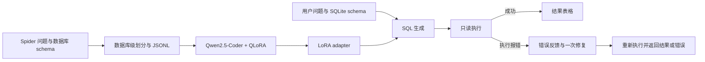

# Text-to-SQL 大模型微调与可执行 SQL 自纠错系统

基于 Qwen2.5-Coder、Spider 和 QLoRA 实现自然语言到 SQL 的训练、评估与查询服务。系统将数据库 schema 纳入模型输入，在 SQLite 执行生成的 SQL，并将执行错误反馈给模型进行一次修复。

**技术栈：** Python · Qwen2.5-Coder · Transformers · PEFT · bitsandbytes · FastAPI · SQLite

## 功能与设计

- **指令数据构建：** 从 Spider 解析表、列、主键和外键，将问题、schema 与 SQL 转换为 prompt/completion JSONL。
- **数据库级划分：** 按 `db_id` 分组划分开发数据，检查训练、验证和测试数据库互斥，保存数据哈希和划分清单。
- **Completion-only SFT：** 屏蔽 prompt 和 padding 的 loss，仅监督 SQL completion；过滤超长样本，避免 SQL 被截断或全部 label 都被屏蔽。
- **参数高效微调：** 4-bit NF4 基座加载与 LoRA adapter 训练，提供单卡、小样本和多卡启动入口。
- **可执行评估：** 保留逐条预测与初始/修复后指标；区分 SQL 执行失败、执行成功但答案错误和数据错误。
- **执行反馈修复：** 仅将预测 SQL 的执行错误交给模型，不使用标准答案来修复预测。
- **查询服务：** FastAPI API 与 Web 页面，数据库目录白名单、只读连接、查询超时和结果行数限制。



## 三分钟体验查询流程

无需下载模型或 Spider 数据，使用人工示例库体验执行与修复流程：

```bash
python -m venv .venv
# Linux/macOS
source .venv/bin/activate
# Windows PowerShell 则执行：.\.venv\Scripts\Activate.ps1
python -m pip install -r requirements-demo.txt
python -m pip install -e . --no-deps
python examples/demo.py --output-dir examples/demo_databases
python -m text2sql_finetune.serve --demo-mode --db-root examples/demo_databases
```

访问 [查询页面](http://127.0.0.1:8000) 或 [API 文档](http://127.0.0.1:8000/docs)。从页面提供的示例问题开始，查看初始 SQL、执行错误、修复 SQL 和查询结果。

`--demo-mode` 使用固定脚本预测器；页面明确标识演示模式。它用于验证应用链路，不能代表 Qwen 的推理能力或 Spider 准确率。真实模型推理使用下文的服务命令。

`requirements-demo-lock.txt` 保存本地工程验证使用的精确依赖版本；可用它替换上述 Demo 依赖文件。训练依赖与 GPU 环境独立记录。

## 项目结构

```text
configs/                 模型训练参数与 smoke 配置
src/text2sql_finetune/    数据转换、训练、生成、评估与服务
scripts/                 Windows / Linux 运行入口
web/                     查询与修复过程展示页面
examples/                人工示例库生成脚本
tests/                   数据划分、loss 掩码、执行与服务测试
docs/                    评估协议、发布指南与简历说明
results/                 本地工程验证记录
.github/workflows/       自动化工程检查
```

## 训练环境

完整 QLoRA 训练建议使用 Linux NVIDIA GPU 环境；Python 3.10 或 3.11。RTX 3090 相关脚本是启动配置，运行时仍需检查驱动、CUDA、依赖和显存。

```bash
bash scripts/00_setup_conda_cu118.sh text2sql
conda activate text2sql
python -m pip install -e . --no-deps
```

手动安装时，先安装匹配驱动的 PyTorch CUDA wheel，再安装 `requirements-train-cu118.txt`。该文件提供依赖版本范围；实际训练环境由运行输出的环境记录追溯。

## 数据处理

从 [Spider 官方网站](https://yale-lily.github.io/spider) 获取数据，按其使用条款将原始文件放入：

```text
data/raw/spider/
  tables.json
  train_spider.json
  train_others.json
  dev.json
  database/<db_id>/<db_id>.sqlite
```

```bash
python -m text2sql_finetune.prepare_data \
  --spider-dir data/raw/spider --out-dir data/processed --seed 42
```

训练来源为 `train_spider.json` 与 `train_others.json`，验证/项目测试来源为官方 `dev.json` 的数据库级拆分。这不是 Spider 隐藏官方测试集。数据库分组后，验证和测试样本数不保证各为 517；以 `dataset_meta.json` 的实际输出为准。

数据集统计、来源哈希、数据库清单和 seed 随处理结果保存。原始数据和完整处理数据不提交到 GitHub。

## QLoRA 训练

默认 1.5B 配置采用 NF4、LoRA rank 64、alpha 128、learning rate 2e-4 与 2048 token 上限，详见配置文件。

```bash
# 单卡
python -m text2sql_finetune.train_qlora --config configs/train_qwen25_coder_1_5b_qlora.yaml

# 多卡：根据实际可用 GPU 数设置进程数
accelerate launch --num_processes 4 --module text2sql_finetune.train_qlora \
  --config configs/train_qwen25_coder_1_5b_qlora.yaml

# 小样本链路验证
bash scripts/run_smoke.sh
```

模型选择使用验证 loss；测试数据不参与 checkpoint 选择。输出包含 adapter、训练状态和运行记录。不同运行应使用不同的 `output_dir`，保留已有权重。

## 评估与复现

```bash
python -m text2sql_finetune.evaluate \
  --base-model Qwen/Qwen2.5-Coder-1.5B-Instruct \
  --adapter-path artifacts/adapters/qwen25-coder-1.5b-spider-qlora \
  --test-file data/processed/test.jsonl --spider-dir data/raw/spider \
  --repair-on-error --max-repair-attempts 1 \
  --out-file artifacts/predictions/test_predictions.jsonl \
  --metrics-file artifacts/predictions/test_metrics.json
```

省略 `--adapter-path` 可评估基座模型。固定验证决策后，同一次最终评估记录初始 SQL 与修复结果；禁止依据测试结果反复调整提示词、训练参数或修复策略。

指标使用本项目实现：字符串匹配保留字面量大小写；执行匹配比较 SQLite 结果、保留重复行，并在标准 SQL 有 `ORDER BY` 时保留结果顺序。它们均不等价于 Spider 官方 component matching 或 test-suite accuracy。完整定义见 [评估协议](docs/EVALUATION.md)。

`results/local_validation.json` 和 [验证记录](results/VALIDATION.md) 记录本地实际执行的工程检查。Qwen 的测试指标须由相应 checkpoint、数据划分、逐条预测与评估输出共同支持。

## 启动真实模型服务

```bash
python -m text2sql_finetune.serve \
  --base-model Qwen/Qwen2.5-Coder-1.5B-Instruct \
  --adapter-path artifacts/adapters/qwen25-coder-1.5b-spider-qlora \
  --db-root data/raw/spider/database
```

接口仅接受服务器数据库目录下的数据库标识。默认绑定 `127.0.0.1:8000`；这是本地查询服务，部署到网络环境还需接入账号权限、审计和数据脱敏。

## 工程检查

```bash
python -m unittest discover -s tests -v
```

GitHub Actions 运行标准库测试与人工库服务测试，无需 GPU。上传与展示方法见 [GitHub 发布指南](docs/GITHUB_GUIDE.md)。

## 参考

- [Spider](https://yale-lily.github.io/spider)
- [Qwen2.5-Coder-1.5B-Instruct](https://huggingface.co/Qwen/Qwen2.5-Coder-1.5B-Instruct)
- [QLoRA 论文](https://arxiv.org/abs/2305.14314)
- [PEFT](https://github.com/huggingface/peft)

外部数据、基座模型和依赖的使用与分发遵循各自许可。
